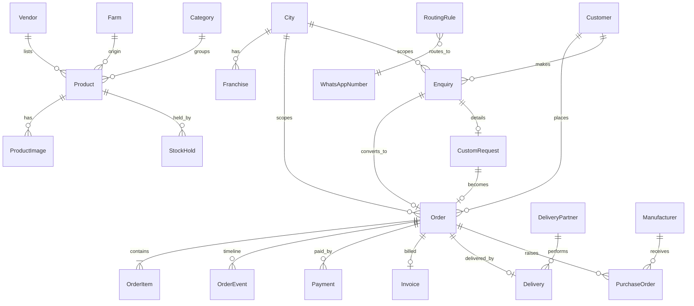

# Data Model

The draft schema is [`packages/db/prisma/schema.prisma`](../packages/db/prisma/schema.prisma). It passes `prisma validate`. It is a **Phase 0 draft for review**: no migrations are generated until Phase 1 is approved. Once a migration is applied it is never edited, and every later change gets a new migration.

## Conventions

| Rule | How it shows in the schema |
|---|---|
| Identity and time | Every table has a `cuid` id, `createdAt` and `updatedAt`. Pure join tables use a composite key. |
| Money | Integer **paise** (`…Paise Int`). Rates are integer **basis points** (`…Bp`, 300 = 3%). There are no floats anywhere money is handled. |
| Measurements | `caratWeight Decimal(8,3)`, `sizeMm Decimal(5,2)`, `weightGrams Decimal(8,3)`. |
| No hard deletes (rule 7) | `archivedAt` on Product, Order, Enquiry, Customer, Address, Category, Collection, Farm and CustomRequest. Configuration records (City, Vendor, Franchise, …) use `isActive`. The API exposes "archive", never "delete", for these. |
| City boundary | Every business record that a city manager or franchise must be scoped by carries `cityId`: Order, Enquiry, Customer, Franchise, CustomRequest, WhatsAppNumber, RoutingRule. |
| Snapshots | Orders copy the address (`addressSnapshot`) and each line copies the SKU, name, price, HSN and GST rate, so editing a product never changes history. |
| Human numbers | A `Sequence` table gives gap-free counters inside the same transaction: order `SP-2610-00001`, invoice `SP/2026-27/00001`, PO `PO-2026-00001`, enquiry `ENQ-26-000001`. |
| Append-only | `AuditLog` and `OrderEvent` are only ever inserted. A raw-SQL migration grants the application role `INSERT, SELECT` only on `AuditLog`. |

## Entities by area

### People
| Entity | Purpose and key fields |
|---|---|
| **User** | Every login. `role` (one of 7), `email`/`phone` (unique), `passwordHash` (staff only), `isActive`. Optional scope links: `cityId` (City Manager), `vendorId`, `franchiseId`, `deliveryPartnerId`. |
| **StaffPermission** | Per STAFF user, per module: `canView/canCreate/canEdit/canDelete`. |
| **AuthSession** | Hashed refresh tokens. Deactivating a user revokes all of them. |
| **OtpChallenge** | Hashed OTP, destination, purpose (login, delivery proof), attempt counter, expiry. |
| **Customer** | 1:1 with a CUSTOMER user. `referralCode` (unique), `referredById`, `cityId`, `isBlocked`, preferred payment method. |
| **Address** | Saved addresses, with an optional link to a serviced City plus free-text city, state and pincode. |
| **DeviceToken** | FCM tokens per user, platform and app (customer / delivery). |

### Network
| Entity | Purpose and key fields |
|---|---|
| **City** | `name`, `slug`, `state`, `isActive`, optional city-specific delivery charge. |
| **Vendor** | Supplier who lists products. Linked to cities through **VendorCity**. |
| **Franchise** | `cityId` (home city), `area`, `address`, contacts, `isActive`. Extra cities served through **FranchiseCity**. |
| **Manufacturer** | Its own record, separate from vendors: name, contact, city, speciality, `isActive`. Receives purchase orders. |
| **DeliveryPartner** | Name, phone, vehicle. Cities through **DeliveryPartnerCity**. 1:1 with a DELIVERY_PARTNER user. |

### Catalogue
| Entity | Purpose and key fields |
|---|---|
| **Category** | Name, slug, image, `isActive`, `sortOrder`, **GST rate and HSN code**, SEO overrides. Cities through **CategoryCity** (no rows means all cities). |
| **Collection** | Curated groups (e.g. "Bridal"). Featured flag for the home page. |
| **Farm** | Name, slug, location and coordinates, story, gallery, SEO. Products and pearl rates link to it. |
| **Product** | SKU, slug, `status` (Draft → Pending approval → Published / Unpublished / Archived), category, collection, farm, vendor; `pricePaise`, `priceOnRequest`, metal, labour and pearl cost; carat, shape, colour, lustre, surface, grade, size, metal, certification; `stockType` (UNIQUE / QUANTITY), `quantity`, `outOfStock` switch, `soldAt`; video; SEO overrides. Cities through **ProductCity**. |
| **ProductImage** | `kind` (main / carousel / lifestyle), `sortOrder` for drag-to-reorder, dimensions. |
| **RelatedProduct** | Ordered self-join. |
| **Certificate** | Certificate of authenticity. Its `code` is encoded in a QR code pointing at `/verify/{code}`, which shows the piece and its farm. |
| **Review** | Rating 1–5, text, photos, `status` (Pending / Approved / Rejected). Tied to the order that triggered the request. |

### Shopping
| Entity | Purpose and key fields |
|---|---|
| **Cart / CartItem** | Guest carts keyed by `guestToken` cookie. They merge into the customer cart on login. `lastActivityAt` and `reminderSentAt` drive abandoned-cart reminders. |
| **WishlistItem** | Customer × product. |
| **StockHold** | Holds stock for one checkout: `productId`, `orderId`, `quantity`, `status` (Active / Converted / Released), `expiresAt` (now + 15 min). |
| **Coupon** | Code, PERCENT (bp) or FLAT (paise), minimum order, maximum discount, first-order-only, date window, total and per-customer limits, active switch, "show on Offers page". Restrictions through **CouponCategory** and **CouponProduct**. |
| **CouponRedemption** | One per order. It is the source for usage counts. |
| **Referral** | Referrer → referee (one per referee), the qualifying order, and the rewards given. |

### Orders
| Entity | Purpose and key fields |
|---|---|
| **Order** | `number`, `source` (checkout / enquiry / manual), `type` (standard / customized), customer, city, address snapshot, assignments (vendor, franchise, manufacturer; the delivery partner is on Delivery), `status`, `paymentStatus`, `paymentMethod`, money fields in paise (subtotal, discount, taxable, GST, delivery, total), coupon code, the enquiry it was converted from. |
| **OrderItem** | Line snapshot: SKU, name, HSN, quantity, unit price, discount, GST rate and amount, line total. |
| **OrderEvent** | Timeline: status changes, payment updates, assignments, notes, with the actor. |
| **Payment** | Online or COD. Gateway order and payment ids (unique), amount, status. COD collection and reconciliation fields. |
| **WebhookEvent** | Idempotency for webhooks: `(provider, eventId)` is unique, so a retried webhook is processed once. |
| **Refund** | Against a payment and optionally a return request. Gateway refund id. |
| **Invoice** | GST invoice numbered per financial year. Intra-state orders get CGST + SGST; inter-state orders get IGST. PDF URL. |
| **ReturnRequest** | Return or cancellation: reason, photos, `status` (Requested → Approved/Rejected → Pickup scheduled → Picked up → Received → Refunded → Closed). |
| **Delivery** | One per order: partner, `status`, timestamps for each step, `failureReason` (required for Failed / Returned), proof photo, signature or OTP proof, `codCollectedPaise`, location captured at delivery, and `lastClientEventId` so offline retries are idempotent. |

### Customized work
| Entity | Purpose and key fields |
|---|---|
| **CustomRequest** | Created from the Customized Jewellery form (through its Enquiry) or by staff. Jewellery type, metal, size, weight, pearl details, design notes, reference images and design files, budget, Ring Finder answers when handed off. Cost breakdown (metal, labour, pearl, margin) → quoted price, advance. `stage` follows the 9 production stages. Links to the resulting Order. |
| **PurchaseOrder** | `number`, manufacturer, order, specification, quantity, agreed cost, due date, `status` (Draft → Sent → Accepted → In production → Received → Closed), PDF. |

### Enquiries
| Entity | Purpose and key fields |
|---|---|
| **Enquiry** | `reference` (included in the WhatsApp message), `type` (product / customized / bulk / ring finder / contact), `stage` (New → In progress → Quoted → Converted → Closed), product, page URL, city, source and UTM, contact, owner, franchise, WhatsApp number used, `clientId` (makes the background retry idempotent), `firstResponseAt` for the response timer, converted order. |
| **EnquiryNote** | Internal notes. |
| **WhatsAppNumber** | Labelled numbers per city, default flag. |
| **MessageTemplate** | Keyed by (`key`, channel, language), `{{placeholder}}` body, optional BSP template name. |
| **RoutingRule** | City and/or enquiry type → WhatsApp number, plus an optional owner or franchise. Ordered by priority, most specific match wins. |

### Content
**Banner** (placement, schedule, mobile image) · **ContentBlock** (keyed JSON blocks for every editable storefront section, including footer address and app store links) · **Page** + **PageVersion** (legal and static pages; every publish is a new version) · **Testimonial** · **GalleryItem** · **Faq** · **JobOpening** · **JobApplication** (resume in private storage, served via signed URLs only).

### Pricing
| Entity | Purpose and key fields |
|---|---|
| **PearlRate** | Rate per carat by grade, farm (optional) and size band. `source` = MANUAL (guaranteed) or FEED. |
| **MarginRule** | Margin in bp by category and/or grade, with optional minimum margin and priority. |

Calculator (in `packages/shared`): `pearlCost = carat × rate(grade, farm, size)`; `cost = pearl + metal + labour`; `suggestedPrice = roundToRupee(cost × (1 + margin))`. GST is added on top at checkout.

### System
**Notification** (campaign or system message, audience JSON, schedule, counts) · **NotificationLog** (every outbound message on every channel, visible in the admin) · **Setting** (key → JSON business setting) · **FeatureFlag** · **AuditLog** · **Sequence**.

### Switched off for now
| Entity | Flag |
|---|---|
| VendorCommission, Settlement | `vendor_commissions` |
| LoyaltyLedger | `loyalty_points` |
| Currency | `multi_currency` (prices stay INR; `Order.currencyCode` defaults to INR) |
| DeliveryLocationPing | `live_gps` |

## Selling a unique piece once (rule 2)

```
BEGIN;
  SELECT * FROM "Product" WHERE id = $1 FOR UPDATE;            -- row lock
  -- reject if status != PUBLISHED, soldAt IS NOT NULL, outOfStock,
  -- or an ACTIVE StockHold exists with expiresAt > now()
  UPDATE "StockHold" SET status='RELEASED' WHERE productId=$1 AND status='ACTIVE' AND expiresAt <= now();
  INSERT INTO "StockHold" (..., status='ACTIVE', expiresAt = now() + interval '15 minutes');
COMMIT;
```

- A raw-SQL migration adds a **partial unique index** `ON "StockHold"(productId) WHERE status = 'ACTIVE'` for UNIQUE products. Even if the application has a bug, the database refuses a second active hold.
- Quantity products decrement `quantity` inside the same locked transaction (`quantity >= requested`).
- A **payment captured** webhook or **COD confirmation** marks the hold CONVERTED and sets `Product.soldAt`, in one transaction.
- A payment failure, cancellation or the BullMQ delayed job at `expiresAt` marks the hold RELEASED. Checkout also re-checks expiry itself, so a lost job cannot keep a piece locked.
- If a payment arrives after its hold expired and the piece was sold to someone else, the order goes to `FAILED`, an automatic refund starts, and staff get an alert. This is tested.

## Full-text search

A raw-SQL migration in Phase 2 adds a generated `tsvector` column on Product (name, SKU, description, shape, colour, farm name) with a GIN index. SKU matches rank first.

## Relationships at a glance



## Seed data (Phase 1)

One Super Admin; two cities (Pune, Mumbai); two farms; categories (Necklaces, Earrings, Rings, Bracelets, Pendants, Loose Pearls) with GST 3% and HSN 7113 / 7101; two collections; about 30 products mixing unique and quantity stock, including price-on-request and sold pieces; one user for each of Staff, City Manager (Pune), Vendor, Franchise (Pune), Delivery Partner and Customer; WhatsApp numbers for Pune, Mumbai and Wholesale with routing rules; default message templates; settings and feature flags (all later features off); legal page drafts; FAQs; a sample coupon.
